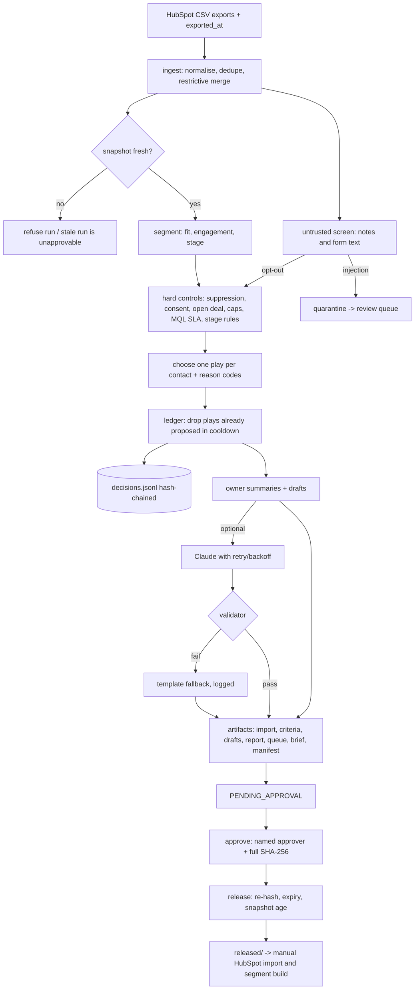

# Architecture and data contracts

## Operator workflow

1. Monday morning: export contacts, engagement, deals and suppression from HubSpot; write `exported_at`.
2. `agent.py run`: the agent proposes one play per contact and writes the run folder.
3. Work the review queue (data fixes, quarantined text, opt-out requests, low-fit hand-raises, unassigned owners).
4. Approve the import, segment criteria and drafts one by one, by hash. Release.
5. In HubSpot, by hand: import the released CSV, build or refresh the segments, attach approved copy, and let owner-task workflows create tasks.
6. Next week's run reads `prior_plays` and the ledger, so it sunsets non-responders and does not repeat plays.

## Flow



Steps checkpoint to `state/runs/<run_id>/`. `run_id` = SHA-256 of the input files, as-of time and policy version, so the same inputs resume or replay the same run.

## Play precedence (first match wins)

| Order | Condition | Play | Channel |
|---|---|---|---|
| 1 | Invalid email, blank or custom lifecycle value | DATA_REVIEW | review |
| 2 | Suppression list or domain, unsubscribed, bounced, consent withdrawn, opt-out in free text, internal or competitor domain | SUPPRESS | list |
| 3 | Any open deal | OWNER_ALERT (deal owner) | owner task |
| 4 | Opportunity stage without open deal | DATA_REVIEW | review |
| 5 | Customer: new (60 days), usage limit or engaged A-fit, dormant, else nothing | ONBOARD, EXPAND, CUSTOMER_CHECK_IN, NO_ACTION | email / owner |
| 6 | SQL 30+ days, no meeting | SQL_ASSIST | owner task |
| 7 | MQL past 48h and not contacted / inside 48h | MQL_SLA_ALERT / NO_ACTION | owner task |
| 8 | Demo or contact-sales form, or 2 pricing views in 14 days | SALES_HAND_RAISE (REVIEW if fit C), stage to MQL if forward | owner task |
| 9 | Re-engagement 30+ days ago, no engagement since | SUNSET | list |
| 10 | No meaningful engagement for 90 days | RE_ENGAGE | email |
| 11 | Created in last 30 days | NURTURE_WELCOME | email |
| 12 | Other early-stage contacts | NURTURE_EDUCATION | email |

Email plays then pass the consent gate (HOLD if not emailable) and the frequency gate (DEFER with a next-eligible date).

## Data contracts

Inputs are described in [SETUP.md](../SETUP.md). Outputs per run:

| File | Contents | Approvable |
|---|---|---|
| `hubspot_import_proposed.csv` | Record ID, Email, lifecycle_next_play, lifecycle_play_reason, lifecycle_play_run_id, Lifecycle Stage (blank or `marketingqualifiedlead`). PROPOSED rows only | yes |
| `list_criteria.json` / `.md` | Custom properties needed and one segment per play with filters; email segments include consent and suppression filters | yes (json) |
| `nurture_drafts.md` | Two template variants per email play (plus a validated Claude variant in Claude mode), unsubscribe placeholder | yes |
| `play_assignments.csv` | Every contact: segment, play, status (PROPOSED, HOLD, DEFER, REVIEW, DUPLICATE, NO_ACTION), reason codes, evidence, route, why-now | no |
| `review_queue.csv` | One row per decision needed, with what to check and empty decision columns | no |
| `segment_report.md`, `brief.md` | Counts by segment and play, data-quality counts, owner tasks | no |
| `decisions.jsonl` | One hash-chained record per contact: play, status, reason codes, evidence IDs, screen results (never note text) | no |
| `manifest.json` | Run metadata, snapshot age, mode, artifact hashes and status | no |
| `approvals.jsonl`, `released/` | Hash-chained approvals and releases; released copies with a release note | created by approve/release |

Decision record example:

```json
{"seq": 4, "run_id": "8efc13122956", "contact_id": "1005", "play": "SUPPRESS", "status": "PROPOSED",
 "reason_codes": ["unsubscribed_from_all"], "evidence_event_ids": [], "play_key": "...",
 "prev_hash": "...", "hash": "..."}
```

## Trust boundaries

- Trusted: policy file, approvers file, structured CRM fields after normalisation.
- Untrusted: notes, form text, event detail, and anything a model returns.
- The model never sees quarantined text, names, or emails. Draft prompts get aggregate counts only. Model output is checked for links, emails, offer language, unknown placeholders, instruction-like text and echoes of quarantined text.

## Where this fits

This is the first deliverable feeding the proposed Marketing Ops control-plane system in my portfolio plan, alongside [lifecycle-stage-audit-agent](https://github.com/rubianaseem/lifecycle-stage-audit-agent) (fixes the stage property) and [hubspot-mcp-slack-approval-agent](https://github.com/rubianaseem/hubspot-mcp-slack-approval-agent) (hash-bound approval for live writes). The control plane itself is designed, not built.
